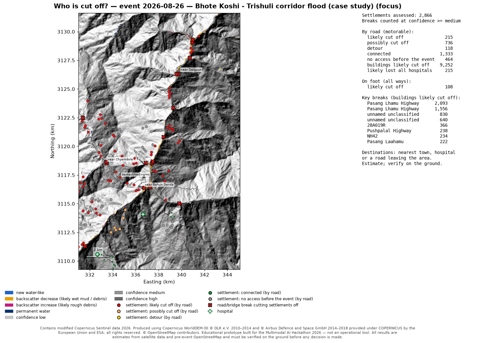

# Sampark — who is cut off after a flood, mapped from space

**Sampark** (सम्पर्क) means *connection* in Hindi and Nepali; Nepali news calls villages cut off
after floods and landslides *सम्पर्कविहीन*, "without connection". The code package and commands
are named `floodmap`.

> **Educational prototype** built for the Multimodal AI Hackathon 2026 (Track B). Not an
> operational tool. All results are estimates from satellite data and pre-event
> OpenStreetMap and must be verified on the ground before any decision is made.

Give it **an area and a flood date**. From free satellite data it answers, for district
emergency centres, helicopter crews and relief teams:

1. **Where did the flood hit?** Flood and debris areas from Sentinel-1 radar before vs after
   (same orbit track), Sentinel-2 when the sky is clear, Copernicus DEM terrain masks, and a
   confidence level for every area.
2. **What was damaged?** Buildings, roads, bridges and health facilities from OpenStreetMap
   *as it was before the event*, flagged "potentially affected", with confidence.
3. **Who is cut off?** Road reachability to the nearest town and hospital before vs after,
   in plain words: *"near Bidur (1,341 buildings): likely cut off by road (likely impassable
   at Pasang Lhamu Highway, 2.87 km away, high confidence) … Needs field verification."*

Also: **our own AI model** (a flood-water segmentation network trained from scratch),
the **flood-path bonus** (trace the flood down the valley from any upstream point),
**rescue priorities**, **helicopter landing-zone candidates**, **later satellite passes**
(receding water, possible lakes forming), a **one-page situation report** and an offline
**field package** (GeoPackage, KML, GPS waypoints). Everything runs on your machine: no
external AI service, nothing about your analysis leaves the computer except the requests
for the public input data.



---

## Contents
1. [Results at a glance](#results-at-a-glance)
2. [Run it from scratch](#run-it-from-scratch)
3. [Analyse any area and date](#analyse-any-area-and-date) (what judges will do)
4. [How to read the results](#how-to-read-the-results)
5. [How it works](#how-it-works)
6. [The AI component: our own segmentation model](#the-ai-component-our-own-segmentation-model)
7. [Case study vs Copernicus EMS (EMSR927)](#case-study-vs-copernicus-ems-emsr927)
8. [Testing](#testing)
9. [Limitations](#limitations)
10. [Data rules, security, attributions, licences](#data-rules)

---

## Results at a glance
**Case study: Bhote Koshi – Trishuli corridor flood, Nepal, 26 Aug 2026** (area 1,792 km²,
run `20261013T103517Z_6d540fab`; every number comes from that run's `results.json`):

| Question | Answer (estimates; verify on the ground) |
|---|---|
| Where did the flood hit? | **15.60 km²** potentially affected (high confidence 10.46 · medium 2.41 · low 2.72) |
| What was damaged? | **3,332** of 107,091 pre-event buildings potentially affected (2,524 high confidence); **80.5 km** of motorable road; **163** bridges |
| Who is cut off? | **215** of 2,866 settlements likely cut off by road (**9,252** buildings), 736 possibly; key breaks on the Pasang Lhamu Highway |
| Landing zones | candidates for 172 of the 215 settlements; none found for 43 (steep gorge) |
| Later passes | 4 dates on the same track: water 0.65 → 1.02 km², 3 possible lakes forming (verify) |

**Checked against the official Copernicus EMS maps (EMSR927, checking only; the method was
frozen before they were opened):** wherever we flag damage, EMS agrees at **precision
0.91–1.00**. In the wide valley (Bidur) the extent overlap reaches **IoU 0.78**, and 0.68 at
Phosretar. In the narrow upper gorge we find about **30 %** of the EMS-mapped area, mostly
because steep slopes and radar shadow sit outside our terrain-plausible zone. **39 of 52** of
our key road breaks lie on roads EMS graded as damaged. Details:
[validation/results.md](validation/results.md).

The one-page situation report generated by the system for this run:
[docs/images/trishuli_sitrep.png](docs/images/trishuli_sitrep.png).

---

## Run it from scratch
Requires **Python 3.11–3.13** (developed on 3.12, Windows 11; also tested in CI on Ubuntu)
and a free **Copernicus Data Space Ecosystem** account (the Sentinel data source named in the
hackathon brief). No GPU needed.

### 1. Install
```bash
git clone https://github.com/itskiee/floodmap.git
cd floodmap
python -m venv .venv
.venv/Scripts/python -m pip install --require-hashes -r requirements.txt   # Windows
# .venv/bin/python -m pip install --require-hashes -r requirements.txt     # Linux / macOS
.venv/Scripts/python -m pip install --no-deps -e .
```
`--require-hashes` makes pip check every package against the SHA-256 in
`requirements.txt`; installation stops if anything does not match. On Linux/macOS use
`.venv/bin/python` wherever this README says `.venv/Scripts/python`.

### 2. Log in to Copernicus Data Space (once)
1. Create a free account at https://dataspace.copernicus.eu.
2. Run the login and follow the link it prints (sign in, confirm the code):
   ```bash
   .venv/Scripts/python -m floodmap login
   ```
   The login token is stored in your user profile, never in this repository.

### 3. Check everything is ready
```bash
.venv/Scripts/python -m floodmap doctor
```
It checks Python, packages, the configuration, disk space, the Copernicus login and
catalogue, **a tiny Copernicus processing request** (proves that login, credits and the
processing service work), the ohsome API with a small pre-event OpenStreetMap download, and
the segmentation model file. Run it before every demo.

### 4. Run the case study
```bash
.venv/Scripts/python -m floodmap run --event configs/events/trishuli_2026.yaml
```
Prints every stage with its status (ok / partial / skipped / failed), time and a one-line
result, and writes `outputs/<run id>/`.

### 5. Open the dashboard
```bash
.venv/Scripts/python -m floodmap dashboard
```
Opens http://localhost:8501 (local only, no usage statistics). Open a previous run, or start
**New analysis** for any area and date with live progress. Tabs: situation report, where /
what / who, rescue priorities, landing zones, later passes, flood path, AI model, data &
limitations. The report (PDF/PNG/text), affected areas and layers (GeoJSON), settlements,
the priority list (CSV) and landing zones can be downloaded.

### 6. The one-page situation report
Written automatically at the end of every run (`outputs/<run id>/report/sitrep.pdf`, `.png`
and a plain-text `.txt` for radio/SMS relay). To rebuild it for a run:
```bash
.venv/Scripts/python -m floodmap report --run outputs/<run id>
```

---

## Analyse any area and date
```bash
.venv/Scripts/python -m floodmap run --bbox MIN_LON MIN_LAT MAX_LON MAX_LAT --date YYYY-MM-DD --name "my area"
```
Example (Melamchi flood, Nepal, 2021):
```bash
.venv/Scripts/python -m floodmap run --bbox 85.50 27.78 85.62 27.92 --date 2021-06-15 --name "Melamchi"
```
Options:
- `--flood-path-start LON LAT`: trace the flood path from an upstream point (bonus) and list
  the settlements along it. Any point near the river works; it snaps to the channel.
- `--later-passes`: also track the later satellite passes of the same track (is the water
  going down, is new water ponding, is a lake forming behind debris?). Optional follow-up,
  off by default because it adds about 4–8 minutes and right after a flood those passes
  usually do not exist yet. The case study switches it on in its event file; in the
  dashboard it is a checkbox, and a finished run offers "Track later passes for this area".
- `--stages s1,terrain,…`: run only some stages (the ones they need are added).
- Or write an event file like [configs/events/trishuli_2026.yaml](configs/events/trishuli_2026.yaml)
  and use `--event FILE`. The same is possible in the dashboard (**New analysis**).

**Limits and timing**
- Area: 0.5–2,500 km² (larger areas get a clear message; split them).
- Date: any flood date in the Sentinel-1 era (from late 2014). The system picks the
  first radar image *after* the date and up to three *before* it on the same orbit track,
  and needs pre-event OpenStreetMap from ohsome (snapshot: the day before the event, or the
  latest ohsome data if older).
- Measured on 13 unseen places (with later passes on): 11–45 minutes per new area of
  330–960 km², most of it waiting for Copernicus Data Space; mountain valleys took 12–21
  minutes, large lowland floods the longest. Later passes account for 3.5–8 minutes of that
  (now optional). A repeated run is served from the cache in seconds to a few minutes.
  Details: [docs/testing/unseen_places.md](docs/testing/unseen_places.md).
- When something is missing (no radar pass yet, cloudy optical image, no OSM roads), that
  stage reports *skipped* with the reason and the rest of the analysis still runs. A stage
  never crashes the whole run.

**What is in `outputs/<run id>/`**

| Folder / file | Contents |
|---|---|
| `results.json` | every number, stage status, message and file; the only source for the dashboard and the report |
| `s1/`, `s2/`, `terrain/`, `confidence/` | change images, terrain masks, flood/debris map with confidence (GeoTIFF, GeoJSON, PNG) |
| `osm/`, `damage/` | pre-event OSM layers; potentially affected buildings, roads, bridges, health facilities |
| `cutoff/`, `priority/` | settlements with cut-off status and sentence, key breaks, ranked rescue priorities (CSV, GeoJSON) |
| `segmentation/` | our model's water map and its agreement with the change detection |
| `flood_path/`, `landing_zones/`, `multidate/` | bonus and extras |
| `report/` | the one-page situation report (PDF, PNG, text) |
| `exports/` | field package zip: GeoPackage, KML, GPX waypoints, report, README, licences |

OSM-derived files carry `LICENSE_OSM_DATA.txt` (ODbL).

---

## How to read the results
- **Flood/debris classes** (radar change between before and after): *new water-like*,
  *backscatter decrease (likely wet mud / debris)*, *backscatter increase (likely rough
  debris)*. Radar sees change in the surface, not damage itself.
- **Confidence** (high / medium / low): how many independent detections agree (the two
  radar tracks, and Sentinel-2 when the sky is clear), counted only where the terrain makes
  flooding plausible (height above the river, slope, no radar shadow).
- **"Potentially affected"**: the building, road or bridge lies in or next to detected
  flood/debris (buffers: buildings 10 m, roads 10 m, facilities 20 m; bridges also when the
  river reach next to them changed). It does not mean destroyed.
- **Cut-off status** (motorable roads; foot paths shown separately):
  - *likely cut off*: every route to the nearest town / hospital / road out of the area
    crosses a break of medium or high confidence;
  - *possibly cut off*: only low-confidence breaks separate it;
  - *detour*: still reachable, but the route is much longer;
  - *connected*; *no access before the event* (no mapped road even before).
  Every cut-off sentence ends with "Needs field verification".
- **Rescue priority tiers** (transparent, no hidden score): 1 likely cut off by road *and*
  buildings potentially affected; 2 likely cut off by road; 3 buildings potentially affected
  but still reachable; 4 possibly cut off or long detour. Within a tier, more affected
  buildings first. The reasons are listed with each settlement.
- **Landing zones** are *candidates only*: trees, power lines, ground and approach cannot be
  seen in 20–30 m data.
- **Population**: the system counts pre-event OSM buildings only; it does not estimate people.

---

## How it works
One entry point, `floodmap.pipeline.run_pipeline(area, date, config)`, used by the command
line, the dashboard and the tests. Each stage returns ok / partial / skipped / failed with a
reason and never stops the run; all tunable values live in
[configs/default.yaml](configs/default.yaml), each with the reason for its value.

| Stage | What it does |
|---|---|
| `s1` | Sentinel-1 GRD on Copernicus Data Space (calibration, Copernicus DEM terrain correction); before/after pairs on the **same orbit track**, up to two tracks; log-ratio change, speckle filter, thresholds → flood/debris classes |
| `terrain` | Copernicus DEM: slope, height above the nearest river (HAND), radar layover/shadow per track, permanent water |
| `s2` | Sentinel-2 L2A when clear: new water and vegetation stripped (cloud-masked; skipped when too cloudy) |
| `confidence` | combines tracks, polarisations, Sentinel-2 and terrain into high/medium/low, minimum mapping unit |
| `segmentation` | our own U-Net on the after image: a second, independent look at water |
| `osm` | OpenStreetMap from the **ohsome API at a pre-event snapshot**: buildings, roads, bridges, places, hospitals/health facilities; settlements from building groups |
| `flood_path` | bonus: D8 flow tracing on the Copernicus DEM from an upstream point; settlements along the path |
| `damage` | overlay → potentially affected buildings, roads, bridges, health facilities, with confidence |
| `cutoff` | road graph before vs after, reachability to the nearest town, hospital or road leaving the area; first break on the old route; the plain-language sentence |
| `priority` | rescue priority tiers and reasons |
| `landing_zones` | flat, dry, open ground near likely cut-off settlements |
| `multidate` | optional (`--later-passes`): later passes of the same track, same thresholds: receding water, new ponding, possible lakes |
| `report`, `exports` | one-page situation report; field package |

Design notes per milestone (what, why, what if removed, alternatives):
[docs/explainers/](docs/explainers/). Rule-by-rule check against the brief:
[docs/compliance.md](docs/compliance.md).

---

## The AI component: our own segmentation model
The brief's option 1: *"train a model to detect water or debris … using the listed training
data, and show how well it works on Himalayan scenes it has never seen."*

- **Model:** a small U-Net (3 levels, 482,593 parameters) trained **from scratch** (no
  pretrained weights) on the **Sen1Floods11** hand-labelled Sentinel-1 chips, at the
  pipeline's 20 m resolution. It runs locally with onnxruntime (1.9 MB file,
  [models/segmentation/](models/segmentation/)).
- **Held-out accuracy (IoU):** test chips **0.649** (simple radar threshold rule 0.445);
  **Bolivia, an entire flood event never seen in training: 0.648** (rule 0.581; this score
  varies between trainings, see below).
  Published Sentinel-1-only results on this dataset are about 0.64–0.67.
- **Himalayan scenes it has never seen (honest answer):** it transfers poorly to narrow
  gorges. It takes radar shadow on steep slopes for water (the terrain masks remove this)
  and misses the 1–5-pixel-wide debris corridor, which is mostly mud and debris rather than
  open water. Against EMSR927: IoU about 0 in the gorge, 0.26 at Phosretar, with precision
  0.99 where it does flag water. So the change detection stays the primary map and the
  model is a documented second opinion.
- **Improvement attempts did not beat it** (chosen by validation only, decided in advance): a
  4× larger model (validation 0.6285 vs 0.6293), weight averaging (0.6247), brightness
  augmentation (0.6242) and an ensemble of three models (0.6281). The unseen-event score varies between trainings (0.536–0.648), so a
  fair summary is "about 0.54–0.65 against 0.58 for the threshold rule". The limit is the
  training data, not the model: [models/segmentation/experiments.json](models/segmentation/experiments.json).
- Model card with all metrics: [models/segmentation/model_card.json](models/segmentation/model_card.json);
  full discussion: [docs/explainers/M5_segmentation_model.md](docs/explainers/M5_segmentation_model.md).

**Reproduce the training** (about 40 minutes on a laptop CPU, fixed seed):
```bash
.venv/Scripts/python -m pip install --require-hashes -r requirements-train.txt
.venv/Scripts/python scripts/fetch_sen1floods11.py
.venv/Scripts/python scripts/train_segmentation.py --epochs 30
```
The download script fetches only the hand-labelled chips, labels and official splits
(checksum-verified) and refuses the dataset's JRC surface-water folder, which the brief does
not allow.

---

## Case study vs Copernicus EMS (EMSR927)
EMSR927 is used **only to check** results, never as an input (disqualification rule). The
comparison code and results live in [validation/](validation/); the pipeline code cannot
read that folder (enforced by a test). The method (`configs/default.yaml`) was frozen at
commit `048c725` before the reference files were opened; afterwards the config only gained
new sections for the extras, and no flood, damage or cut-off value changed.

| EMS area | Extent IoU | Precision | Recall | EMS-damaged buildings we flagged |
|---|---|---|---|---|
| AOI01 Syabrubesi (gorge) | 0.30 | 0.98 | 0.31 | 170 of 355 |
| AOI02 Timure (gorge) | 0.30 | 1.00 | 0.30 | 131 of 405 |
| AOI03 Bidur (valley) | 0.78 | 0.93 | 0.82 | 1,662 of 2,046 |
| AOI05 Phosretar | 0.68 | 0.91 | 0.72 | 264 of 361 |

(Grading products; our 20 m radar pixels vs their 0.3–1 m photo-interpretation, so perfect
agreement is impossible even for a correct map.) Reproduction steps:
[validation/README.md](validation/README.md).

---

## Testing
```bash
.venv/Scripts/python -m pip install --require-hashes -r requirements-dev.txt
.venv/Scripts/python -m pytest              # offline tests (default, no login needed)
.venv/Scripts/python -m pytest -m network   # live public catalogue / ohsome (no login)
.venv/Scripts/python -m pytest -m cdse      # live Copernicus Data Space processing (login)
.venv/Scripts/pre-commit run --all-files    # secret scan, data rules, lint, hygiene
```
The offline suite includes a full end-to-end run of every stage on recorded data, the
brief's A/B/C/D cut-off example, and the data-rules scanner (with self-tests that plant
violations).

**Unseen places:** besides the case study, the full system was run on places it had never
seen (Himalaya, Europe, South America, desert city, no-flood controls) and on invalid inputs
(future date, open sea, tiny or huge area, …). Results:
[docs/testing/unseen_places.md](docs/testing/unseen_places.md), reproduced with
`scripts/run_unseen_places.py`.

---

## Limitations
The full discussion is in the report; the most important points:
- **Revisit time:** Sentinel-1 passes every few days (2–12 days depending on the track and
  year). The system maps what happened; it **cannot warn** of a sudden glacier collapse or
  debris flow minutes ahead.
- **Narrow gorges:** steep slopes, radar shadow and layover hide parts of the valley floor;
  there we find about 30 % of the EMS-mapped area (but what we find is right).
- **Radar sees surface change, not damage.** "Potentially affected" and "likely cut off"
  are estimates for prioritising field checks, not confirmed facts.
- **OpenStreetMap completeness:** only what was mapped *before* the event counts (e.g.
  Derna 2023 had only 404 buildings mapped before the flood). Missing roads can make a
  village look cut off or connected.
- **Our model** was trained on lowland floods and transfers poorly to Himalayan gorges.
- **Seasonal effects:** monsoon-wet fields, snow and vegetation change can look like water
  or debris to radar.
- **Needs a Sentinel-1 before/after pair on the same orbit track.** Where none exists, the
  system says so and does not map the flood; mapping from Sentinel-2 alone is not
  implemented (future work). Example: over Porto Alegre (Brazil) in 2024, when only one
  Sentinel-1 satellite was flying, there is no radar image at all between February and the
  flood; the first one is from 8 May 2024 ([docs/testing/unseen_places.md](docs/testing/unseen_places.md)).
- **Built for river-valley floods.** In deserts, dry sand is as dark as water to radar (it can
  be labelled "permanent water"), and rain changes sand and city surfaces everywhere; in
  flat, dense cities scattered detections then cut many roads, so cut-off counts there are
  not reliable (seen on the Dubai 2024 test, [docs/testing/unseen_places.md](docs/testing/unseen_places.md)).
- **False alarms** also occur without a flood (ploughing, harvests, shorelines, construction);
  a no-flood control still shows scattered, mostly low-confidence detections.

---

## Data rules
Only the inputs the brief allows, from the sources it names:
- **Sentinel-1, Sentinel-2, Copernicus DEM GLO-30** from the Copernicus Data Space Ecosystem;
- **OpenStreetMap as it was before the event**, via the ohsome API (`https://api.ohsome.org/v1`)
  with an explicit pre-event snapshot;
- **Sen1Floods11** (training data of our model).

Not used as inputs: Copernicus EMS / EMSR927 (checking only, in `validation/`), UNOSAT or any
other damage map, post-event OSM edits, population rasters, other land-cover or water
datasets. Enforced at runtime (allowlists in `src/floodmap/data_rules.py`) and statically
(`tests/test_data_rules.py`).

## Security
See [SECURITY.md](SECURITY.md). No secrets are needed in the repository: the Copernicus
login token stays in your user profile. Dependencies are pinned with SHA-256 hashes and
audited; CI runs without any secrets. No external AI service is used.

## Updating dependencies
```bash
.venv/Scripts/uv pip compile pyproject.toml --universal --python-version 3.11 --generate-hashes --no-header -o requirements.txt
.venv/Scripts/uv pip compile pyproject.toml --extra dev --universal --python-version 3.11 --generate-hashes --no-header -o requirements-dev.txt
.venv/Scripts/uv pip compile pyproject.toml --extra train --universal --python-version 3.11 --generate-hashes --no-header --constraints requirements-dev.txt -o requirements-train.txt
```

## Attributions
- Contains modified Copernicus Sentinel data 2026.
- Produced using Copernicus WorldDEM-30 © DLR e.V. 2010–2014 and © Airbus Defence and
  Space GmbH 2014–2018 provided under COPERNICUS by the European Union and ESA; all
  rights reserved.
- © OpenStreetMap contributors.
- Validation (checking only): European Union, Copernicus Emergency Management Service data.

Training data of our segmentation model: Bonafilia, D., Tellman, B., Anderson, T.,
Issenberg, E. (2020). Sen1Floods11: a georeferenced dataset to train and test deep learning
flood algorithms for Sentinel-1. CVPR Workshops 2020. (Kuro Siwo is not used.)

## Responsibility
No images of victims are used anywhere. This is an educational prototype, not an
operational tool: every map, report and export says so, and every result must be verified
on the ground.

## License
Code: MIT (see [LICENSE](LICENSE)). Data derived from OpenStreetMap: Open Database License
(ODbL) 1.0. Model weights: trained on Sen1Floods11, for non-commercial educational use.
